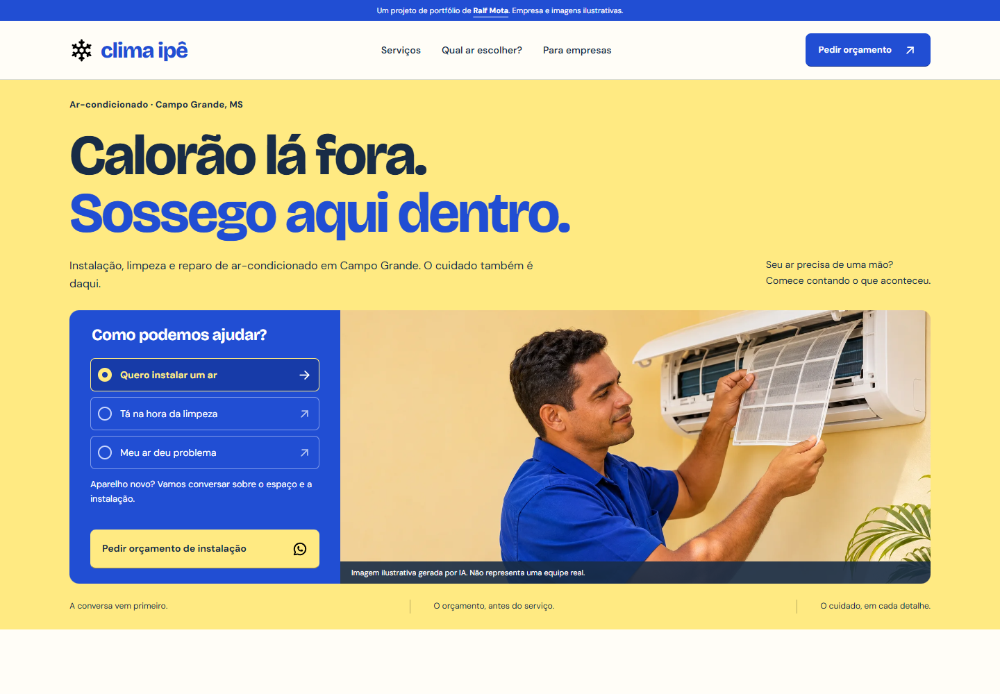

# SaaS Clima Ipê

Projeto desenvolvido para atender empresas do segmento de climatização, com apresentação de serviços, estimativa de capacidade de ar-condicionado e preparação de pedidos de orçamento.

## Proposta para o segmento

Reunir em um site os serviços da empresa e as informações que o cliente precisa para iniciar o atendimento. O percurso permite escolher o serviço, informar características do ambiente e preparar uma solicitação de orçamento com contexto.

A solução contempla a apresentação de instalação, limpeza, reparo e manutenção programada para ambientes comerciais. Identidade, região de atendimento, conteúdo e contato podem ser adaptados à empresa.

## Requisitos e funcionalidades implementadas

| Requisito | Comportamento do sistema |
|---|---|
| Apresentação dos serviços | Seções para instalação, limpeza e reparo, com ações de orçamento específicas. |
| Seleção da necessidade | A escolha do serviço atualiza a orientação e a mensagem de contato. |
| Estimativa em BTU/h | Considera área, quantidade de pessoas, eletrônicos e incidência de sol da tarde. |
| Validação dos dados | Aceita área de 4 a 200 m², de 1 a 30 pessoas e de 0 a 20 eletrônicos, com mensagens junto aos campos. |
| Sugestão de capacidade | Indica a capacidade comercial seguinte à estimativa, até 60.000 BTU/h; valores superiores orientam avaliação específica. |
| Atualização do resultado | Alterações nos dados invalidam o cálculo anterior para evitar pedidos com estimativas desatualizadas. |
| Orçamento contextual | Prepara uma mensagem com os dados do ambiente e a capacidade estimada ou com o serviço selecionado. |
| Atendimento empresarial | Apresenta manutenção programada e orientações sobre atendimento de ambientes comerciais. |
| Perguntas frequentes | Respostas expansíveis para apoiar a decisão do visitante. |

A calculadora fornece uma estimativa inicial. O dimensionamento definitivo depende de avaliação profissional do ambiente.

## Experiência de uso

- Layout responsivo para celulares, tablets e computadores.
- Menu móvel com indicação de estado, fechamento ao navegar e suporte à tecla Escape.
- Navegação por teclado, foco visível e rótulos nos campos.
- Mensagens de erro associadas às entradas e anúncio de atualização do resultado para tecnologias assistivas.
- Tema claro ou escuro conforme a preferência do sistema.
- Respeito à preferência de redução de movimento.

## Versão para celular

## Especificações técnicas

| Camada | Implementação |
|---|---|
| Estrutura | HTML5 semântico |
| Interface | CSS com Grid, Flexbox e adaptações por largura de tela |
| Interações | JavaScript nativo para validação, cálculo e preparação de contato |
| Recursos visuais | Imagens WebP responsivas, fontes WOFF2 e ícones SVG locais |
| Carregamento | Imagens fora da abertura carregadas sob demanda e scripts deferidos |
| Publicação | Arquivos estáticos, sem etapa obrigatória de build |
| Verificação | Testes de cálculo com Node.js e verificações de interface com Playwright e axe-core |

## Estágio atual e adaptação comercial

A versão atual implementa a interface e as interações no navegador. O contato está em modo demonstrativo. A configuração de um número comercial permite abrir o WhatsApp com a mensagem preparada; o envio depende da ação do visitante.

Painel administrativo, cadastro, banco de dados, pagamentos e agenda conectada ficam fora do escopo atual. A adaptação para uma empresa inclui validar marca, serviços, região de atendimento, imagens, contato e hospedagem.

Clima Ipê é a marca fictícia utilizada na demonstração. As fotografias são ilustrações geradas por IA.

## Demonstração

As capturas acima apresentam a interface. O link de acesso e o vídeo serão incluídos quando publicados.

## Código-fonte

O código completo é mantido em repositório privado. Este espaço público reúne a apresentação, as especificações resumidas e capturas do projeto.

## Desenvolvimento

[Ralf Mota](https://github.com/RalfMota). 
